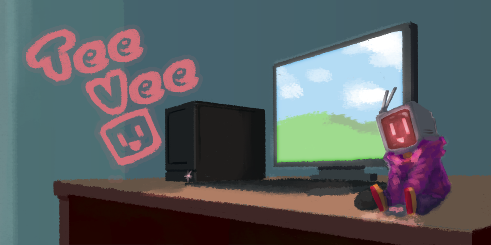

# TeeVee

A desk robot with a face that has feelings. It reacts when you pet it, poke it, praise it or scold it; it gets bored, sleepy and
lonely; it yawns, sleeps, peeks in its sleep and changes its look; and a small neural network learns what you like and shapes how it behaves.

The same face runs in these places:

- **ESP32 "Cheap Yellow Display"** (ESP32-2432S028R): 320 x 240 touch screen. The main board.
- **Lilka v2** (ESP32-S3 handheld): 280 x 240 screen, buttons instead of touch.
- **Waveshare ESP32-S3 Touch AMOLED 1.8**: 368 x 448 touch screen with a motion sensor, a microphone and a speaker. The face uses the
  middle of the panel, and the clock and weather sit in the bands above and below it.
- **Desktop** (Windows, macOS, Linux): a window with controls and a picture-in-picture mode, and it can live in the tray (`--tray`).
- **Browser**: the face as WebAssembly, installable as an app, with every look option and a share link for your look.

## What it can do

- **Feelings**: an emotion model (pleasure, arousal, dominance) with moods, needs (attention, rest, play) and a slowly drifting temperament.
- **A mind of its own**: a small recurrent network turns what it senses into urges (where to look, smile, blink, yawn, sleep,
  turn its head, change its look...) and learns from your reactions. You can watch it think: the desktop's mind panel (key I)
  and the web page's Mind tab show what drives each urge.
- **Looks**: 40 presets, plus every option on its own: eye and pupil shapes, ten mouths, glow, pixelate, glitch, RGB split, day tint,
  separate settings for each eye, a turning 3D head and a fisheye lens (desktop and web).
- **Apps**: small sandboxed Lua scripts that draw on the screen, react to touch or buttons, save data, fetch web pages and are part of
  the face (rock paper scissors where the robot really is happy to win). Twenty-four samples in [`apps/`](apps/): games against the robot
  (Simon around its face, a reaction duel, memory pairs, quiz, tic-tac-toe, guess my number, rock paper scissors, snake), care (its
  needs, and a petting game), and alarm, bounce, clock, clockface, countdown, counter, dice, fetch (shows a web page), hello, level,
  pomodoro, stopwatch, timer, weather.
- **Its own web page** on the board: change its look and settings, upload apps, see its mind, update its firmware.

## Build

| What | How |
|---|---|
| Board firmware | `pio run -e cyd`, `-e lilka` or `-e amoled`, then `-t upload` ([PlatformIO](https://platformio.org/)) |
| Desktop | `cmake -S desktop -B build && cmake --build build` (Qt 6; SDL3 is downloaded and built in if it is not installed) |
| Windows from Linux | see [`desktop/mingw-w64.cmake`](desktop/mingw-w64.cmake) |
| Browser | `web/build.sh` (Emscripten), then serve `web/dist/` |
| Tests | `make -C test` (host tests), `make -C test golden-check` (renderer pixel regression) |

GitHub Actions ([`.github/workflows/`](.github/workflows/)) builds the firmware for both boards, the desktop app for all three
systems and the web page, and runs the tests.

The first time a board starts it opens a Wi-Fi hotspot; its name and password are on the screen. Join it and the page that opens
sets up your Wi-Fi. Nothing private is built into the firmware.

## Packs and backup

A `.tvpack` is one file that moves between the board, the desktop app and the web page. A pack holds looks, a behaviour file, apps and pictures, and is safe to share; each place takes what it can use and says what it skipped (apps and pictures need a board). A full backup also holds settings and what the robot has learned, so keep it private, and installing one replaces what is there only if you say so. Neither ever holds Wi-Fi details, the PIN or the login token.

- Board: Setup tab, `python3 tools/pack.py send file.tvpack`, or the card's `/teevee/packs/` with `sd pack <name>`.
- Desktop: the Packs button in `teevee-qt`.
- Web page: the Look tab.
- Make your own from a folder: `python3 tools/pack.py make myfolder out.tvpack`.

## Background apps

One app at a time can also run with nothing on the screen: if it defines `background(dt)`, choose it with the page's Apps tab or `app bg <name>` on the console. It gets a call once a second and can use `face.*` and its saved data, but not the network. It pauses while another app is on the screen, because the board's RAM does not hold both. Apps get about 22 KB for Lua on the CYD; with a large one on the screen the web page may stop answering until you leave it with the BOOT button. See `apps/alarm.lua`.

## Screen off

After 10 minutes with nobody doing anything the board's display goes dark, and the robot carries on living. A touch or a button turns it back on, and that first press does nothing else. It stays on for an app, a timer, the login PIN and the Wi-Fi setup details. Change the wait with `cfg screen_off <minutes>` or in the page's settings; 0 means never.

## Behaviour as a file

How it behaves can be changed without building anything: how fast its needs grow, how long between its own emotes, the five personalities' numbers, which emotes each event earns, and a new robot's instincts. Print every setting with `python3 tools/apps.py behaviour`, edit what you want, and put it back: `behaviour.txt` beside the desktop app's saves, the card's `/teevee/behaviour.txt` or `apps.py behaviour file.txt` on a board, or the Look tab's button on the web page. Lines it leaves out keep their defaults, a bad line is skipped and reported, and numbers are held to their range.

## License

[MIT](LICENSE), for the project's own code. The parts below keep their own licenses.

## Third-party code

- [Lua 5.4](https://www.lua.org/) (MIT license), vendored in `lib/lua` with small marked changes.
- Font bitmaps generated from [Noto Sans](https://fonts.google.com/noto) (SIL Open Font License 1.1).
- The desktop app uses [SDL3](https://libsdl.org/) (zlib license); `teevee-qt` also uses [Qt 6](https://www.qt.io/) (LGPL v3).
